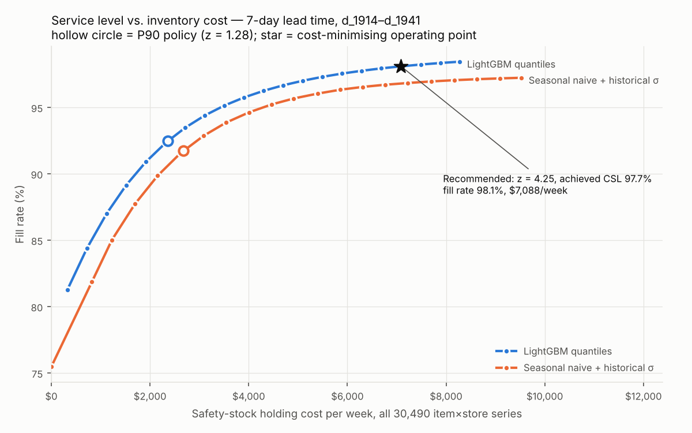

# Hierarchical Demand Forecasting (M5)

Forecasting 28 days of daily unit sales for Walmart's M5 data across the full
12-level hierarchy (**42,840 series**). Covers honest baselines, a global
LightGBM model, probabilistic forecasts, intermittent-demand methods,
reconciliation across levels and a reorder-point decision layer.

**Headline results** (rolling origin, 4 × 28-day windows, expanding training window):

| | Seasonal naive | ETS | ARIMA | **LightGBM (bottom-up)** |
|---|---:|---:|---:|---:|
| Mean MASE, 12 levels equally weighted | 1.126 | 0.932 | 0.959 | **0.812** |
| WAPE, total level | 0.087 | 0.064 | 0.075 | **0.049** |
| WAPE, item × store | 0.875 | **0.741** | 0.749 | 0.761 |

- One global LightGBM model trained on all 30,490 series beats every
  per-series statistical model at levels 1–9 by a wide margin. At the
  noisiest levels (item, item × store) it is on par with ETS.
- P90 forecasts cover 89.2% of outcomes (nominal 90%). Their pinball loss
  is 15% lower than a weekday empirical-quantile baseline.
- MinT-shrink reconciliation, run matrix-free on the 42,840-series
  hierarchy, improves ETS's cross-level MASE from 0.928 to 0.886 and
  makes the forecasts coherent.
- Reorder points from the quantile forecasts need **20–36% less safety-stock
  holding cost** than a naive "average + historical σ" rule at the same fill rate.

---

## Contents

- [Data](#data) · [How to run](#how-to-run) · [Layout](#layout)
- [Phase 1 — Baselines](#phase-1--baselines) · [Phase 2 — Metrics](#phase-2--metrics)
- [Phase 3 — Rolling-origin backtest](#phase-3--rolling-origin-backtest)
- [Phase 4 — Global LightGBM](#phase-4--global-lightgbm)
- [Phase 5 — Probabilistic forecasts](#phase-5--probabilistic-forecasts)
- [Phase 6 — Intermittent demand](#phase-6--intermittent-demand)
- [Phase 7 — Reconciliation](#phase-7--reconciliation)
- [Phase 8 — Decision layer](#phase-8--decision-layer)
- [Leakage risks and how each is handled](#leakage-risks-and-how-each-is-handled)
- [Limitations](#limitations)

## Data

`data/` holds the M5 files as zstd parquet (converted from CSV by `data/shrink.py`):

| File | Shape | Contents |
| --- | --- | --- |
| `sales_train_evaluation.parquet` | 30,490 × 1,947 | Daily unit sales d_1–d_1941 (2011-01-29 → 2016-05-22) |
| `calendar.parquet` | 1,969 × 14 | Dates, weekdays, events, SNAP flags |
| `sell_prices.parquet` | 6,841,121 × 4 | Weekly price per store × item |

Verified: 30,490 bottom series (3,049 items × 10 stores), 1,941 days
(5.3 years), 3 states, 3 categories, 7 departments, **68.0% zero-sales days**.

`m5fc.data.build_hierarchy()` aggregates the bottom series into the 12 M5
levels with a sparse summing matrix S (the same S is reused for bottom-up
and reconciliation):

| Level | Grouping | Series | | Level | Grouping | Series |
| ---: | --- | ---: |---| ---: | --- | ---: |
| 1 | Total | 1 | | 7 | State × Department | 21 |
| 2 | State | 3 | | 8 | Store × Category | 30 |
| 3 | Store | 10 | | 9 | Store × Department | 70 |
| 4 | Category | 3 | | 10 | Item | 3,049 |
| 5 | Department | 7 | | 11 | State × Item | 9,147 |
| 6 | State × Category | 9 | | 12 | Item × Store | 30,490 |

## How to run

```bash
pip install -r requirements.txt
python -m pytest                       # 27 tests, ~2 s
./scripts/run_all.sh                   # every model at every origin (~12 h on 4 cores, resumable)
python scripts/evaluate.py             # Phases 2-3: MASE / WAPE by level and origin
python scripts/evaluate_quantiles.py   # Phase 5
python scripts/evaluate_intermittent.py  # Phase 6
python scripts/run_reconcile.py        # Phase 7
python scripts/run_decision.py         # Phase 8
```

Forecasts are written per `(origin, model, level)` under `outputs/forecasts/`
(git-ignored), so every runner skips work already done. Tables land in `results/`.

Runs were made in a 4-core, 14 GB container. Memory is the binding
constraint: the LightGBM feature matrix (22.5 M rows) peaks at ~7.4 GB, so
`run_all.sh` runs jobs one at a time.

## Layout

```
src/m5fc/
  data.py          hierarchy, summing matrix, long format for statsforecast
  baselines.py     seasonal naive, AutoETS, AutoARIMA
  metrics.py       MASE, WAPE, pinball, coverage (and MAPE, to show why not)
  features.py      leakage-safe feature matrix for the global model
  gbm.py           LightGBM point (Tweedie) and quantile models
  intermittent.py  Croston, SBA, TSB; Syntetos-Boylan demand classes
  reconcile.py     BU / OLS / WLS / MinT-shrink, matrix-free
  inventory.py     reorder points and service-level evaluation
scripts/           one runner or evaluator per phase, plus run_all.sh
results/           every table and figure quoted here
tests/             27 unit tests (GitHub Actions: .github/workflows/test.yml)
```

## Phase 1 — Baselines

| Model | Implementation | Notes |
| --- | --- | --- |
| Seasonal naive | numpy | Forecast = value 7 days earlier (repeat the last week). The MASE reference. |
| ETS | `statsforecast.AutoETS(season_length=7)` | Error/trend/season form chosen per series by AICc. |
| ARIMA | `statsforecast.AutoARIMA(season_length=7)` | Orders capped at p,q ≤ 2, P,Q ≤ 1; CSS approximation during order search. |

Every model is fit on every one of the 42,840 series at every origin.

- **Leading zeros are trimmed** before fitting. In M5 they mostly mean the
  item was not stocked yet, not zero demand.
- **ETS and ARIMA see the last 730 days.** Two years covers the weekly and
  annual pattern and bounds cost.
- **Restricted ARIMA search.** The default AutoARIMA search measured
  ~1.2 s/series on 4 cores (~14 h per origin); the restricted search takes
  ~0.14 s/series (104 min per origin).
- **One BLAS thread per worker.** With default threading, the statsforecast
  worker processes oversubscribed the CPU and ETS ran ~10× slower.

Runtime per origin, all 42,840 series: seasonal naive < 1 s, ETS ~37 min, ARIMA ~104 min.

## Phase 2 — Metrics

`m5fc/metrics.py`:

- **MASE** = MAE of the forecast ÷ in-sample MAE of the lag-7 seasonal naive,
  computed per series from its first sale. Scale-free, so it averages
  across series of any volume. The denominator is in-sample, so the seasonal
  naive itself does not score exactly 1 on a test window (~1.15 here):
  each test window is harder than the average training week.
- **WAPE** = Σ|error| ÷ Σ|actual| over all series and days of a level. It is
  volume-weighted: high sellers dominate, as they do in revenue.
- **No MAPE.** 68% of bottom-level days are zero, so MAPE divides by zero
  on most observations. `metrics.mape` exists only to demonstrate that.
- Levels are averaged with **equal weight** (the M5 convention), so the
  30,490 bottom series do not swamp the single total series.

## Phase 3 — Rolling-origin backtest

Four origins with an expanding window: train on d_1–d_1829 and forecast
d_1830–d_1857; train on d_1–d_1857 and forecast d_1858–d_1885; and so on, up
to d_1914–d_1941. Never a single split, never shuffled. Full tables are in
[`results/metrics.md`](results/metrics.md), and per-origin rows are in
`results/metrics_by_origin.csv`.

**Mean MASE by level, averaged over the 4 origins:**

| Level | sNaive | ETS | ARIMA | LightGBM | | WAPE sNaive | WAPE ETS | WAPE LightGBM |
|---|---:|---:|---:|---:|---|---:|---:|---:|
| 1 Total | 1.149 | 0.853 | 0.992 | **0.642** | | 0.087 | 0.064 | **0.049** |
| 2 State | 1.072 | 0.875 | 0.951 | **0.670** | | 0.095 | 0.078 | **0.060** |
| 3 Store | 1.091 | 0.898 | 0.955 | **0.780** | | 0.107 | 0.088 | **0.073** |
| 4 Category | 1.090 | 0.844 | 0.910 | **0.670** | | 0.096 | 0.074 | **0.057** |
| 5 Department | 1.257 | 1.122 | 1.009 | **0.823** | | 0.108 | 0.091 | **0.067** |
| 6 State × Cat | 1.051 | 0.854 | 0.879 | **0.732** | | 0.110 | 0.091 | **0.070** |
| 7 State × Dept | 1.178 | 1.040 | 0.990 | **0.841** | | 0.124 | 0.108 | **0.083** |
| 8 Store × Cat | 1.070 | 0.866 | 0.949 | **0.811** | | 0.128 | 0.106 | **0.089** |
| 9 Store × Dept | 1.179 | 1.000 | 1.013 | **0.891** | | 0.149 | 0.127 | **0.107** |
| 10 Item | 1.102 | **0.883** | 0.912 | 0.905 | | 0.387 | **0.325** | 0.337 |
| 11 State × Item | 1.115 | **0.912** | 0.925 | 0.932 | | 0.576 | **0.474** | 0.487 |
| 12 Item × Store | 1.153 | 1.032 | **1.028** | 1.051 | | 0.875 | **0.741** | 0.761 |
| **Avg of 12** | 1.126 | 0.932 | 0.959 | **0.812** | | 0.237 | 0.197 | **0.187** |

By origin (cross-level MASE, d_1829 / d_1857 / d_1885 / d_1913):

| Model | d_1829 | d_1857 | d_1885 | d_1913 |
|---|---:|---:|---:|---:|
| Seasonal naive | 1.212 | 1.043 | 1.143 | 1.105 |
| ETS | 0.943 | 0.877 | 0.937 | 0.970 |
| ARIMA | 1.042 | 0.931 | 0.892 | 0.973 |
| LightGBM | **0.923** | **0.833** | **0.722** | **0.771** |

LightGBM is best at every origin and every model beats the seasonal naive
every time. ETS beats ARIMA overall (0.932 vs 0.959) and at three of four
origins. ARIMA is closest at the bottom levels (item × store MASE 1.028 vs
1.032) and weaker at aggregate levels, where the restricted order search
likely costs it most.

## Phase 4 — Global LightGBM

One model across all 30,490 item × store series (`m5fc/features.py`, `m5fc/gbm.py`):

- **Sales features:** lags 28, 35, 42, 49, 56, 91 and 364; rolling means
  over 7/28/56/112 days and a 28-day std, all ending at lag 28; the share
  of zero days.
- **Lags start at 28, the horizon.** One model then forecasts all 28 days
  directly: the lag-28 value for the last test day is the last observed
  day. Lags 7 and 14 would require recursive forecasting (feeding
  predictions back in, compounding error) or would leak actuals.
- **Price:** sell price, price ÷ running max of past prices (a causal
  "discount depth"), week-on-week price change.
- **Calendar:** weekday, month, year, day of month, event name/type, SNAP
  flag for the series' state.
- **IDs as categoricals:** item, department, category, store, state. This
  is what lets one model share patterns across series and handle new items.
- **Training window:** 2 years (22.5 M rows), Tweedie objective (count data
  with many zeros). Early stopping uses the last 28 days *before* the
  origin. Training takes ~4 min per origin.

Top features by gain (d_1913 point model): 56-day mean 33%, 112-day mean
30%, 28-day mean 21%, item ID 7%. Recent level dominates; weekday and
events refine it.

**Global vs. local:** the global model wins clearly wherever series aggregate
(levels 1–9: cross-level MASE 0.77 vs 0.97 for ETS). At the item × store level
it ties ETS (MASE 1.051 vs 1.032, WAPE 0.761 vs 0.741). At that level the
signal-to-noise ratio is low, and per-series models already capture each
item's level.

**MAE rewards the median.** LightGBM's P50 model, used as a point forecast,
gets the best bottom-level MASE of any model (0.871). But it under-forecasts
total volume by 35%, because the median of an intermittent series is often
0. A metric built on absolute error rewards that. For replenishment,
use the mean or explicit quantiles, never the MAE-optimal point.

## Phase 5 — Probabilistic forecasts

LightGBM with `objective='quantile'` at α = 0.1, 0.5, 0.9, scored by pinball
loss at the bottom level (d_1913). Full results are in
[`results/quantiles.md`](results/quantiles.md).

| Model | Pinball P10 | Pinball P50 | Pinball P90 | 80% interval coverage |
|---|---:|---:|---:|---:|
| LightGBM quantile | 0.1415 | **0.4941** | **0.3240** | 88.3% |
| Weekday empirical quantile (last 8 weeks) | **0.1408** | 0.5073 | 0.3832 | 90.6% |

**Calibration check.** For count data a correct α-quantile satisfies
P(y < q) ≤ α ≤ P(y ≤ q), since ties at integer values, mostly 0, are common.

| Quantile | Nominal | P(y ≤ q) | P(y < q) | Verdict |
|---|---:|---:|---:|---|
| P10 | 0.10 | 0.545 | 0.008 | consistent (mostly 0, legitimately) |
| P50 | 0.50 | 0.625 | 0.274 | consistent |
| P90 | 0.90 | 0.892 | 0.890 | **slightly under-covers** (89.2% vs 90%) |

The P90 is the quantile that matters for inventory, and it is close to calibrated.
The empirical baseline over-covers (P90 at 91.9%) and pays for it with 18%
higher pinball loss. By demand class, P90 coverage ranges from 88.1%
(erratic) to 90.5% (smooth). No quantile crossing occurs (0.0%; erratic 0.6%).

Coherent quantiles at every level are covered under Phase 7.

## Phase 6 — Intermittent demand

Series are classified on each origin's training window with the
Syntetos–Boylan–Croston scheme. ADI is the mean interval between sales and
CV² the squared coefficient of variation of non-zero sizes, with cut-offs
1.32 and 0.49:

| Class | Share of series | Zero-sales days |
|---|---:|---:|
| Smooth | 6.2% | 14% |
| Erratic | 2.8% | 17% |
| **Intermittent** | **72.8%** | 67% |
| **Lumpy** | **18.2%** | 54% |

So 91% of item × store series are intermittent or lumpy. Croston-family
methods were compared with the other models on them, averaged over 4 origins
([`results/intermittent.md`](results/intermittent.md)):

| Intermittent + lumpy series | sNaive | ETS | ARIMA | Croston | SBA | **TSB** | LightGBM |
|---|---:|---:|---:|---:|---:|---:|---:|
| Mean MASE | 1.174 | 1.059 | 1.053 | 1.119 | 1.103 | **1.052** | 1.078 |
| Volume bias | −7.6% | −4.7% | −4.7% | **+1.2%** | −3.9% | −3.5% | −5.1% |

- **TSB** is the most accurate method on intermittent series. It updates
  the *probability* of a sale every period, so it decays towards zero for
  items that stop selling. Croston cannot do that, because it only updates
  when a sale happens.
- **Croston** has the textbook upward bias (+1.2%). **SBA's** (1 − α/2)
  correction removes it and overshoots slightly (−3.9%), as expected.
- None of the methods beats ETS or ARIMA by a wide margin: on a 28-day horizon,
  a flat demand-rate forecast is close to what AutoETS converges to on
  sparse series anyway.

## Phase 7 — Reconciliation

Independent per-level forecasts do not add up: ETS's forecasts at levels
1–11 miss the sum of their item × store forecasts by 2–8% of volume. Reconciliation maps all
42,840 base forecasts to coherent ones with ỹ = S G ŷ (`m5fc/reconcile.py`):

| Method | G |
|---|---|
| Bottom-up | use the bottom level only |
| OLS | (S′S)⁻¹S′ |
| WLS-struct | weights ∝ 1 / number of bottom series |
| WLS-var | weights = 1 / error variance from past origins |
| **MinT-shrink** | full error covariance from past origins, shrunk towards its diagonal (Schäfer–Strimmer) |

**Scale:** with 30,490 bottom series, S′W⁻¹S is a dense 30,490² matrix
(7 GB). Nothing is formed explicitly: S is sparse, the shrinkage covariance
is "diagonal + rank-k" so W⁻¹v comes from the Woodbury identity, and the
system is solved with preconditioned conjugate gradients for all 28 horizons
at once (~1–2 min per reconciliation). Every method is tested against the
dense closed-form formula on a small hierarchy.

**Non-negativity:** MinT left up to a third of bottom forecasts negative;
clipping them lifted the total forecast by 25%. The
*set-negative-to-zero* heuristic fixes negative bottom series at zero and
re-solves for the rest (Kourentzes & Athanasopoulos, 2021).

Results averaged over d_1857, d_1885 and d_1913. d_1829 is excluded because
the covariance needs errors from earlier origins.
Full tables: [`results/reconciliation.md`](results/reconciliation.md).

| Base forecasts → | Base | BU | OLS | WLS-struct | WLS-var | MinT-shrink |
|---|---:|---:|---:|---:|---:|---:|
| ETS at every level: cross-level MASE | 0.928 | 0.931 | 0.948 | 0.916 | 0.909 | **0.886** |
| ETS at every level: cross-level WAPE | 0.196 | 0.194 | 0.197 | 0.194 | 0.193 | **0.192** |
| ETS levels 1–11 + LightGBM bottom: MASE | 0.929 | **0.776** | 0.948 | 0.894 | 0.836 | 0.866 |
| Incoherence (Σ\|y − S·y_bottom\| ÷ Σ\|y\|), levels 1–11 | 1.7–7.7% | 0 | 0 | 0 | 0 | 0 |

- With ETS base forecasts, **MinT-shrink is the best method** and is
  coherent by construction. The shrinkage intensity λ ≈ 0.75 shows that
  with only 56–84 past error vectors, the off-diagonal covariance is
  mostly noise.
- With a strong bottom-level model, **plain bottom-up wins**: the weaker
  ETS upper-level forecasts only drag the combination down. Reconciliation
  helps most when base forecasts at different levels carry complementary
  information.

**Coherent quantiles at every level** (`results/hierarchical_quantiles.md`):
reconciled point forecast plus per-series empirical quantiles of that method's
past errors. At the item × store level, MinT P90 coverage is 87.8%. At
aggregate levels the intervals under-cover (total P90 at 82%). One origin's
28 aggregate errors are strongly autocorrelated, so three past origins are
effectively three draws. This needs more origins, or a parametric
lead-time model, before being used for upper-level decisions.

## Phase 8 — Decision layer

`m5fc/inventory.py`, `scripts/run_decision.py`. A continuous-review policy
with a 7-day replenishment lead time sets each item × store's reorder point to

ROP = μ_L + z · σ_L,

where μ_L is the sum of daily LightGBM point forecasts over the lead time.
σ_L comes from the forecast's own quantile spread: daily σ ≈ (P90 − P10) / 2.563,
summed in variance over 7 days. z = 1.28 is the "P90 policy". Sweeping z
traces the curve below, evaluated on realised demand in the four 7-day
windows of d_1914–d_1941.

Costs (assumptions): holding 25% of sell price per year, and a lost sale
costs a 30% margin.



| Fill-rate target | Holding cost/week — LightGBM quantiles | Holding cost/week — naive + historical σ | Saving |
|---:|---:|---:|---:|
| 85% | $816 | $1,226 | 33% |
| 90% | $1,712 | $2,194 | 22% |
| 95% | $3,432 | $4,293 | 20% |
| 97% | $5,086 | $7,916 | 36% |

**Recommended operating point:** z = 4.25, i.e. achieved cycle service level 97.7%,
fill rate 98.1%, $7,088/week holding vs $6,403/week lost margin. With a 30%
margin against ~0.5%/week holding, the newsvendor critical ratio is ≈ 0.98,
so a high service level is the right call.

**Calibration caveat:** achieved service falls short of the nominal target
(a 90% target delivers 86.8%). Summing daily variances assumes independent
days, but retail demand is positively autocorrelated, so the lead-time σ is
understated. The fix is to read service off the achieved axis, as the
chart does, or to calibrate z on a past window.

## Leakage risks and how each is handled

| Risk | Where it would bite | Guard |
|---|---|---|
| **Future sales in features** | rolling means/lags computed on the full series | The sales matrix is truncated at the origin *before* any feature is computed. A test scrambles every post-origin value and asserts identical features. |
| **Lags shorter than the horizon** | lag-7 at a test day 20 days out is an unobserved actual | Lags start at 28 (= horizon); no recursion. |
| **Full-series scaling statistics** | normalising by a mean/max that includes the test window | MASE scales use only the training window; price is normalised by a *running* max of past prices; no global standardisation anywhere. |
| **Future promo / price flags** | using prices or events that would not be known in advance | Calendar events and SNAP days are published ahead in M5. Prices for the 28-day window are assumed to be *planned* prices, known in advance. This is an assumption, stated, not a given; without it, use the last known price. |
| **Early stopping on the test window** | tuning the round count on what you report | Early stopping uses the 28 days before the origin. |
| **Error covariance from the test window** | MinT/WLS-var estimated from the window they are scored on | Covariances use errors from strictly earlier origins only, with an assertion. This bug was actually present and caught: the leaky MinT cut bottom-level MASE from 1.03 to 0.88; fixed, that gain vanishes (1.046 → 1.050) and the cross-level gain is a realistic 0.928 → 0.886. |
| **Shuffled or single splits** | optimistic, unstable estimates | Rolling origin with expanding window; four non-overlapping 28-day windows. |
| **Leading zeros as demand** | items not yet stocked counted as zero-sales days | Series are trimmed at their first sale for fitting, scaling and features. |

## Limitations

- Four origins span four consecutive months (Mar–May 2016). Seasonal
  effects outside spring, such as Christmas and Thanksgiving, are not
  tested out of sample.
- ARIMA uses a restricted order search, and ETS/ARIMA see two years of
  history, both for compute. A full search may change ARIMA's ranking
  slightly.
- LightGBM hyperparameters were set once, for compute (lr 0.1, 127 leaves,
  50% bagging), and not tuned. Bottom-level accuracy is the most likely
  place a tuned or horizon-specific model would gain.
- Quantile models were trained at the final origin only (the point model at
  all four). Calibration is therefore measured on one 28-day window.
- The decision layer ignores order quantities, capacity, and the joint
  replenishment of items in one store. It is a reorder-point comparison,
  not a full inventory simulation.
- Upper-level prediction intervals under-cover (see Phase 7).
