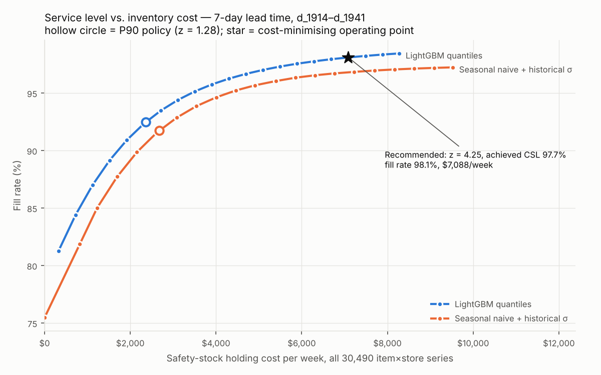

# Decision layer — reorder points at origin d_1913 (7-day lead time)

Assumptions: holding cost 25% of sell price per year; lost sale costs 30% margin; costs in $ per week summed over all 30,490 series.

**Recommended operating point (min holding + lost margin, LightGBM):** z = 4.25 (nominal CSL 100.00%) -> achieved CSL 97.7%, fill rate 98.1%, holding $7,088/week, lost margin $6,403/week.

Achieved cycle service level falls short of the target at high targets: summing daily variances assumes independent days, but retail demand is positively autocorrelated, so the lead-time sigma is understated. The curve is still the right decision tool — read service off the achieved column, not the target.

## LightGBM quantile policy

| z | target_csl | cycle_service_level | fill_rate | safety_stock_units | holding_cost_per_week | lost_margin_per_week | total_cost_per_week |
|---|---|---|---|---|---|---|---|
| 0.000 | 0.500 | 0.661 | 0.813 | 15100.997 | 324.679 | 57316.794 | 57641.473 |
| 0.250 | 0.599 | 0.715 | 0.844 | 40037.247 | 725.713 | 47721.230 | 48446.942 |
| 0.500 | 0.691 | 0.762 | 0.870 | 64837.497 | 1122.476 | 39844.121 | 40966.597 |
| 0.750 | 0.773 | 0.801 | 0.892 | 89652.247 | 1519.472 | 33329.121 | 34848.594 |
| 1.000 | 0.841 | 0.836 | 0.909 | 114491.497 | 1916.975 | 28032.787 | 29949.762 |
| 1.250 | 0.894 | 0.865 | 0.923 | 139323.747 | 2315.018 | 23692.734 | 26007.752 |
| 1.500 | 0.933 | 0.888 | 0.935 | 164108.247 | 2712.257 | 20232.791 | 22945.048 |
| 1.750 | 0.960 | 0.907 | 0.944 | 188959.747 | 3109.675 | 17467.086 | 20576.761 |
| 2.000 | 0.977 | 0.922 | 0.951 | 213775.747 | 3507.442 | 15212.351 | 18719.793 |
| 2.250 | 0.988 | 0.935 | 0.958 | 238685.247 | 3907.126 | 13375.737 | 17282.863 |
| 2.500 | 0.994 | 0.944 | 0.963 | 263511.997 | 4304.729 | 11873.848 | 16178.577 |
| 2.750 | 0.997 | 0.952 | 0.967 | 288262.497 | 4700.346 | 10647.883 | 15348.229 |
| 3.000 | 0.999 | 0.958 | 0.970 | 313154.247 | 5099.150 | 9621.888 | 14721.038 |
| 3.250 | 0.999 | 0.963 | 0.973 | 337980.747 | 5496.635 | 8746.930 | 14243.565 |
| 3.500 | 1.000 | 0.968 | 0.976 | 362821.247 | 5895.421 | 8005.287 | 13900.708 |
| 3.750 | 1.000 | 0.971 | 0.978 | 387585.497 | 6291.235 | 7395.247 | 13686.482 |
| 4.000 | 1.000 | 0.974 | 0.979 | 412467.247 | 6689.884 | 6848.831 | 13538.715 |
| 4.250 | 1.000 | 0.977 | 0.981 | 437296.997 | 7087.571 | 6403.036 | 13490.607 |
| 4.500 | 1.000 | 0.979 | 0.982 | 462122.497 | 7485.872 | 6021.441 | 13507.312 |
| 4.750 | 1.000 | 0.981 | 0.983 | 486970.247 | 7882.876 | 5682.064 | 13564.940 |
| 5.000 | 1.000 | 0.982 | 0.984 | 511747.247 | 8279.191 | 5391.776 | 13670.967 |

## Seasonal naive + historical sigma policy

| z | target_csl | cycle_service_level | fill_rate | safety_stock_units | holding_cost_per_week | lost_margin_per_week | total_cost_per_week |
|---|---|---|---|---|---|---|---|
| 0.000 | 0.500 | 0.554 | 0.755 | 0.000 | 0.000 | 74335.734 | 74335.734 |
| 0.250 | 0.599 | 0.681 | 0.819 | 44774.000 | 822.098 | 52519.895 | 53341.993 |
| 0.500 | 0.691 | 0.726 | 0.850 | 71914.000 | 1227.901 | 43679.668 | 44907.569 |
| 0.750 | 0.773 | 0.774 | 0.877 | 100952.000 | 1693.862 | 35682.516 | 37376.378 |
| 1.000 | 0.841 | 0.814 | 0.899 | 129714.000 | 2155.199 | 29363.609 | 31518.809 |
| 1.250 | 0.894 | 0.849 | 0.915 | 158405.000 | 2616.093 | 24358.572 | 26974.665 |
| 1.500 | 0.933 | 0.877 | 0.929 | 187577.000 | 3085.653 | 20459.430 | 23545.082 |
| 1.750 | 0.960 | 0.898 | 0.939 | 216091.000 | 3540.367 | 17508.695 | 21049.063 |
| 2.000 | 0.977 | 0.915 | 0.946 | 245116.000 | 4006.384 | 15264.971 | 19271.354 |
| 2.250 | 0.988 | 0.929 | 0.952 | 273914.000 | 4465.334 | 13512.768 | 17978.102 |
| 2.500 | 0.994 | 0.938 | 0.957 | 301961.000 | 4909.999 | 12227.191 | 17137.190 |
| 2.750 | 0.997 | 0.947 | 0.960 | 331708.000 | 5395.297 | 11141.699 | 16536.996 |
| 3.000 | 0.999 | 0.955 | 0.963 | 360645.000 | 5860.486 | 10267.842 | 16128.328 |
| 3.250 | 0.999 | 0.959 | 0.965 | 389267.000 | 6315.434 | 9672.637 | 15988.070 |
| 3.500 | 1.000 | 0.963 | 0.967 | 417439.000 | 6762.128 | 9210.549 | 15972.677 |
| 3.750 | 1.000 | 0.966 | 0.968 | 446413.000 | 7226.277 | 8840.151 | 16066.429 |
| 4.000 | 1.000 | 0.968 | 0.970 | 475606.000 | 7697.298 | 8501.777 | 16199.075 |
| 4.250 | 1.000 | 0.970 | 0.971 | 504735.000 | 8167.211 | 8238.645 | 16405.855 |
| 4.500 | 1.000 | 0.972 | 0.971 | 533195.000 | 8620.025 | 8028.823 | 16648.848 |
| 4.750 | 1.000 | 0.973 | 0.972 | 562441.000 | 9092.217 | 7846.184 | 16938.400 |
| 5.000 | 1.000 | 0.974 | 0.972 | 590219.000 | 9526.849 | 7718.675 | 17245.523 |

## Holding cost to reach the same fill rate

| fill_rate_target | lightgbm_cost | naive_cost | saving_pct |
|---|---|---|---|
| 0.850 | 815.411 | 1225.538 | 0.335 |
| 0.900 | 1712.053 | 2193.784 | 0.220 |
| 0.925 | 2375.971 | 2956.717 | 0.196 |
| 0.950 | 3432.237 | 4292.966 | 0.200 |
| 0.960 | 4104.278 | 5344.369 | 0.232 |
| 0.970 | 5086.118 | 7916.325 | 0.358 |

